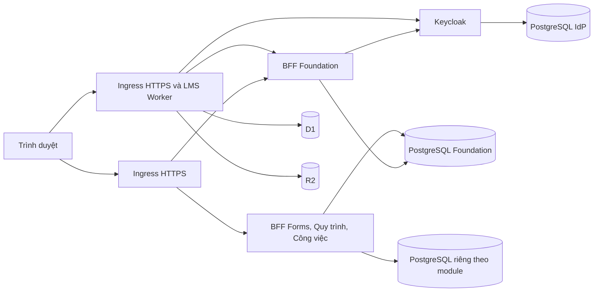

# Môi trường nghiệm thu enterprise

Baseline đối chiếu ngày 12/11/2026, giờ Việt Nam. Nhánh `feat/foundation-mvp`, HEAD `abea705b0937fe164fa9c983700089bec88c82ba`, worktree có tệp sửa và tệp chưa theo dõi. Digest snapshot ghi lại đầu vào thực tế của mỗi lần dựng. [Rà soát baseline](ENTERPRISE_READINESS_AUDIT.md)

## Entry point, dữ liệu và trách nhiệm

| Workload                           | Entry point đã đối chiếu                                                       | Dữ liệu và ranh giới trách nhiệm                                                                                                                                                                                                            |
| ---------------------------------- | ------------------------------------------------------------------------------ | ------------------------------------------------------------------------------------------------------------------------------------------------------------------------------------------------------------------------------------------- |
| Ingress TLS của bài thử Foundation | `dist/scripts/staging.js`                                                      | Mỗi client có listener HTTPS loopback riêng. Ingress bỏ forwarding headers do caller gửi, xác thực lượt chuyển vào BFF trên loopback và đặt scheme HTTPS. Cấu hình chứa slot, issuer, client, runtime role, khóa và dấu nhận diện instance. |
| BFF Portal và client kiểm chứng    | `src/app.ts`, `scripts/dev.ts` cho local                                       | Foundation sở hữu danh tính liên kết, tổ chức, phân quyền, phiên và audit Foundation. OIDC/JWKS/introspection lấy từ Keycloak. DB owner chạy migration. Runtime đọc marker và ghi nghiệp vụ, audit theo quyền cấp.                          |
| Forms, Quy trình, Công việc        | Các boundary tương ứng trong `src/`                                            | Cùng mã BFF, client OIDC và PostgreSQL nghiệp vụ riêng. Domain nhận actor/phạm vi từ boundary do Foundation vận hành. Mỗi module sở hữu migration, lịch sử và các bảng nghiệp vụ của nó.                                                    |
| Nền Quy trình và Công việc         | `scripts/work-center-worker.ts`, timer Công việc trong `src/tasks-boundary.ts` | Quy trình xử lý nhắc, job và outbox trong phạm vi module. Công việc tự xử lý nhắc hạn. Ownership và trạng thái chuyển tiếp dựa trên dữ liệu nguồn.                                                                                          |
| LMS                                | `src/lms/worker.ts`, gói `dist/lms/worker.mjs`                                 | Worker cần OIDC, hợp đồng tích hợp Foundation, D1 và R2. LMS sở hữu cấu hình đào tạo, phiên bản nội dung, thi, tiến độ và media. Local dùng Miniflare và worker nhắc hạn.                                                                   |
| Keycloak                           | Keycloak 26.8.2                                                                | IdP sở hữu client, khóa ký, credential và phiên IdP. PostgreSQL IdP dùng role và database riêng.                                                                                                                                            |
| Hệ thống ngoài AIO                 | Hợp đồng integration của Foundation và các adapter                             | Ownership và mapping của nguồn chủ phải được xác định trước mỗi tích hợp. Giai đoạn nghiệm thu dùng dữ liệu giả lập.                                                                                                                        |

Các vai trò trong bảng mô tả trách nhiệm kỹ thuật theo ranh giới dữ liệu. Người trực vận hành, chủ nghiệp vụ, giờ phục vụ, lưu lượng thực tế, retention và ngân sách pilot chờ quyết định. Ngưỡng đo thử giữ theo [roadmap](../roadmap/GOAL_ENTERPRISE_READINESS.md#ngưỡng-đề-xuất-cho-môi-trường-thử).



Forms, Quy trình, Công việc và LMS đã qua hai slot HTTPS staging ngày 12/11/2026. Truy cập Foundation từ các BFF nghiệp vụ đi qua boundary cấp actor và phạm vi. Worker LMS dùng API tích hợp.

### Kết nối ứng dụng trên v37

Đối chiếu ngày **14/11/2026, giờ Việt Nam**. Bảng này ghi kết nối runtime của artifact v37 và phần người soạn có thể cấu hình. Hạ tầng dựng, npm registry và nguồn advisory được ghi riêng trong tài liệu pipeline. [Bản dựng và quét](ENTERPRISE_RELEASE_BUILD.md) · [OWASP ASVS V13](https://github.com/OWASP/ASVS/blob/v5.0.0/5.0/en/0x22-V13-Configuration.md)

| Nguồn → đích | Dữ liệu và cấu hình đích | Bằng chứng |
| --- | --- | --- |
| Browser → Portal, Forms, Quy trình, Công việc, LMS và Keycloak | Mỗi client có hostname của slot. OIDC dùng realm và callback dựng từ cấu hình. Hành động quản trị đưa người dùng tới trang tài khoản IdP. | Receipt hostname v37 xác minh TLS, các cookie theo host, MFA và logout có chữ ký. |
| BFF và LMS → Keycloak, Keycloak → callback ứng dụng | Discovery, JWKS, đổi mã, introspection và logout. BFF giới hạn origin issuer. Adapter LMS kiểm cả origin và tiền tố đường dẫn realm. Keycloak dùng callback logout riêng của từng client. | Hai slot qua luân chuyển RSA và backchannel. Cấu hình client trình duyệt đã quan sát trực tiếp tại slot A. |
| LMS ↔ Foundation và Quy trình → LMS | LMS gọi API tích hợp Foundation để lấy quyền, Directory, liên kết nhân sự và tra đề nghị đào tạo. Portal lấy dữ liệu công việc từ nguồn. Quy trình gửi đề nghị đào tạo tới LMS theo endpoint cố định và proof ký theo thao tác. | Runner kiểm quyền nguồn, thao tác không cấp quyền và replay chỉ tạo một lần giao ở cả hai slot. |
| BFF, Keycloak, audit writer → PostgreSQL, LMS → D1/R2 | Kết nối PostgreSQL dùng TLS và role tách theo kho. D1/R2 là binding giả lập thuộc instance LMS. Audit projection dùng writer, collector và reader riêng. | Fault v37 kiểm outage và phát lại audit. Recovery v37 đối soát dữ liệu và tệp từ đích mới. |
| AIO → OpenBao và ClamAV | OpenBao nhận AppRole một lần và cấp bí mật theo workload qua TLS. Upload scan qua relay mTLS đến ClamAV. Adapter scanner, audit và telemetry của LMS là binding nội bộ; các địa chỉ `.invalid` là định danh cho binding. | Receipt fault kiểm lỗi scanner và xoay credential PostgreSQL. Receipt phục hồi xác nhận đủ bốn AppRole. |
| Browser LMS → video ngoài AIO | YouTube và Vimeo tải SDK từ hostname cố định. Google Drive dùng iframe dựng từ ID. URL video HTTPS trực tiếp do người soạn cung cấp và được browser tải qua phần tử media. Worker lưu và kiểm định dạng URL, trong khi đường outbound server staging chỉ mở cho realm và API tích hợp Foundation. | Ca provider dùng fixture SDK. Việc truy cập các dịch vụ video thật cần bằng chứng trong phạm vi được cấp. |
| Quy trình → email | Worker ghi vào hộp thư giả lập trong kho Quy trình. Cấu hình v37 hiện dùng adapter local và hai realm đã quan sát không có SMTP. | Kiểm hộp thư, job và scope tại nguồn. Adapter nhà cung cấp chưa thuộc topology này. |

[Hostname v37](../.local/evidence/enterprise-e3-staging-telemetry-c82f1529.json) · [Fault v37](../.local/evidence/enterprise-e3-v37-fault-review.json) · [Phục hồi v37](../.local/evidence/enterprise-e3-v37-recovery-review.json) · [Nguồn video LMS](LMS_MEDIA.md) · [Adapter outbound LMS](../scripts/staging-lms.ts)

## Chạy Foundation qua hai staging slot

Điều kiện gồm Docker Desktop context `desktop-linux` trên máy này, Node 24, Chromium của Playwright và hai image Keycloak/PostgreSQL theo digest trong [script diễn tập](../scripts/staging-e2e.ts). Hai slot dùng các cổng 4510/4511/4518, 4520/4521/4528 và 55438/55439. Dùng cổng trống. Script tạo PostgreSQL và Keycloak riêng cho từng slot, phát chứng chỉ loopback và cấp bí mật ngẫu nhiên. File bí mật nằm dưới `.local` trong lúc chạy. Foundation giữ marker test cho tương thích phiên bản trước và kiểm thêm receipt instance ngẫu nhiên khi khởi động staging.

```powershell
npm run test:staging -- <release> <manifest-sha256>
npm run test:staging -- <release> <manifest-sha256> <prior-release> <prior-manifest-sha256>
npm run test:staging -- <release> <manifest-sha256> <prior-release> <prior-manifest-sha256> <image-digest>
```

Lệnh thứ hai dựng schema cũ từ gói trước, đăng nhập qua TLS/MFA, ghi grant giả lập, dừng ứng dụng, chạy migration của gói mới và so journal theo checksum lẫn thời điểm áp dụng. Kiểm tiến trình từ chối sai instance trước khi khởi động gói mới. Sau đó chạy lại cùng idempotency key qua phiên đang mở, chuyển về gói trước, so audit và journal, kiểm logout với CSRF. Rollback giữ migration cộng thêm và chạy lại mã cũ.

Lệnh có image digest xác minh nhãn gắn với artifact SHA-256, chạy bản mới bằng container và kiểm đăng nhập MFA mới trên đó. Bridge TCP chỉ phục vụ phòng thử. Nó chuyển cổng loopback của host vào ingress TLS trong container và nối các đích IdP/DB đã định danh trên mạng Docker riêng. Chứng chỉ và cấu hình thử được mount chỉ đọc. Bản trước chạy bằng Node trên host. [Dựng và quét image](ENTERPRISE_RELEASE_BUILD.md)

Để chạy lại diễn tập với gói đã vá và receipt quét image của lần kiểm ngày 12/11/2026, dùng các digest trong hai receipt:

```powershell
$r = Get-Content -Raw .local/releases/e1-alpine-patched-v3/receipt.json | ConvertFrom-Json
$prior = Get-Content -Raw .local/releases/e1-staging-v1/receipt.json | ConvertFrom-Json
$image = Get-Content -Raw .local/releases/e1-alpine-patched-v3/image-a9d7f626/receipt.json | ConvertFrom-Json
if ($image.status -ne 'pass' -or $image.artifactDigest -ne $r.artifactDigest) {
  throw 'Receipt image chưa đạt hoặc không khớp artifact.'
}
npm run test:staging -- e1-alpine-patched-v3 $r.artifactDigest e1-staging-v1 $prior.artifactDigest $image.imageDigest
```

## Profile nghiệp vụ

Thêm `--modules` để chạy Forms, Quy trình và Công việc, hoặc `--suite` để thêm LMS. Trong mỗi slot, các cổng BFF nghiệp vụ là 4513/4515/4516 hoặc 4523/4525/4526. LMS dùng 4514 hoặc 4524. Mỗi PostgreSQL nghiệp vụ có owner, runtime role, tên database và marker instance riêng. Công cụ kiểm quyền CONNECT giữa các kho, quyền DDL, journal và audit. Staging Quy trình dùng worker job hiện có với kiểm marker trước khi bắt đầu.

LMS chạy bundle của artifact trong workerd do Miniflare quản lý với D1/R2 giả lập. Worker chạy trên host với TLS loopback. BFF container truy cập Worker qua relay riêng của slot. Adapter outbound của Worker chỉ đi đến issuer và API tích hợp Foundation của slot, kiểm chứng chỉ bằng CA của lần thử. Khóa mã hóa của Worker được tạo riêng trong runner. [Tài liệu Miniflare](https://developers.cloudflare.com/workers/testing/miniflare/get-started/)

Receipt Foundation, ba BFF nghiệp vụ và toàn bộ suite được ghi lần lượt theo mẫu `enterprise-e1-staging-foundation-<id>.json`, `enterprise-e1-staging-modules-<id>.json` và `enterprise-e1-staging-suite-<id>.json` dưới `.local/evidence`. Lỗi ghi giai đoạn và trạng thái HTTP khi có.

Thêm `--telemetry` cuối lệnh suite có image ứng viên để thu trace qua Portal, LMS và Foundation, kiểm mẫu hàng đợi và tạo dashboard riêng theo slot. [Telemetry và runbook cảnh báo](ENTERPRISE_TELEMETRY.md)

Profile `--full-rollback` chạy đủ BFF và LMS của bản trước, nâng schema rồi chuyển ứng viên → bản trước → ứng viên trên cùng dữ liệu slot. Khi dùng cùng telemetry, đặt `--full-rollback` trước `--telemetry`. [Runbook phát hành và rollback](ENTERPRISE_RELEASE_RUNBOOK.md)

Profile `--scoped-reports --mixed-load` dùng image ứng viên và stack mới theo slot, tự bật telemetry. Chạy riêng với lượt rollback. [Nhịp tải, ngưỡng và biên bản](ENTERPRISE_TELEMETRY.md#đo-tải-hỗn-hợp-e3)

### Đối chiếu image PostgreSQL của staging

Ngày 13/11/2026, gói v5 còn tham chiếu PostgreSQL `17.7-alpine` ở runner gốc. PostgreSQL công bố 17.12 ngày 12/11 với các bản vá bảo mật cho nhánh 17. Lúc **13:12:49 giờ Việt Nam**, xác minh image chính thức `docker.io/library/postgres:17.12-alpine` có digest `sha256:34261f594522cf41dfcb76aefd42b9d201098b0e6b23c9c68733f169e4218b6f` và tiến trình trả phiên bản 17.12. Lượt thử kế tiếp dùng image này trong slot mới và lưu digest hạ tầng cùng digest ứng viên trong receipt. Cần kiểm rollback, phục hồi và tải trên cấu hình đã vá để nghiệm thu. [Công bố PostgreSQL](https://www.postgresql.org/about/news/postgresql-187-1712-1616-1520-1425-and-19-rc-2-released-3442/) · [Danh sách advisory nhánh 17](https://www.postgresql.org/support/security/17/) · [Log xác minh](../.local/evidence/enterprise-postgres-17-12-staging-image.log)

Runner thử lại lấy từ snapshot v5 và kiểm TypeScript. Thay đổi gồm pin PostgreSQL 17.12, ghi hash runner và image hạ tầng, thực hiện IAM/CSRF trước cửa sổ tải. Tập thao tác, nhịp, thời lượng và ngưỡng tải giữ theo roadmap. Khi chạy lại, đối chiếu file runner với SHA-256 `cef862415731aba54f81b78f030f15a849fe32c141f5ba72c5cc6b260814c54a`. [Diff runner](../.local/evidence/enterprise-rc-v5-staging-runner.patch)

Chạy tuần tự từ gốc workspace với bản sao runner đã đối chiếu. Mỗi profile dùng cụm mới và ghi receipt riêng.

```powershell
$r = Get-Content -Raw .local/releases/enterprise-rc-v5/receipt.json | ConvertFrom-Json
$b = Get-Content -Raw .local/releases/e4-task-work-v2/receipt.json | ConvertFrom-Json
$i = Get-Content -Raw .local/releases/enterprise-rc-v5/image-fd51dbe6/receipt.json | ConvertFrom-Json
$runner = '.local/staging-runner-rc-v5/scripts/staging-e2e.ts'
if ($i.status -ne 'pass' -or $i.artifactDigest -ne $r.artifactDigest -or
    (Get-FileHash -LiteralPath $runner).Hash.ToLowerInvariant() -ne 'cef862415731aba54f81b78f030f15a849fe32c141f5ba72c5cc6b260814c54a') {
  throw 'Runner hoặc image không khớp receipt.'
}
& node_modules/.bin/tsx.cmd $runner enterprise-rc-v5 $r.artifactDigest e4-task-work-v2 $b.artifactDigest $i.imageDigest --scoped-reports --full-rollback --telemetry
& node_modules/.bin/tsx.cmd $runner enterprise-rc-v5 $r.artifactDigest $i.imageDigest --infra-audit --telemetry --recover
& node_modules/.bin/tsx.cmd $runner enterprise-rc-v5 $r.artifactDigest $i.imageDigest --scoped-reports --mixed-load
```

Lúc **13:32:02 ngày 13/11/2026, giờ Việt Nam**, Trivy quét đúng config digest của PostgreSQL 17.12 Alpine và ghi **26 phát hiện high/critical** trong Go standard library của `gosu` 1.19, build bằng Go 1.24.6. Lúc **13:35:08** dựng image thử thay executable này bằng `su-exec` 0.3-r0 của Alpine, giữ upstream entrypoint và kiểm UID/GID đích cùng phiên bản PostgreSQL. Image thử có digest `sha256:bbe0009b41f9ec45fe6a6664954472bb1f00f3b7e7c1d1b9a397f6e6a3d45822`. Cần receipt quét và diễn tập lại trước khi dùng image này để chốt. [Receipt quét image gốc](../.local/evidence/enterprise-infrastructure-scan-7ec567ca/postgres.json) · [Dockerfile upstream](https://github.com/docker-library/postgres/blob/master/17/alpine3.24/Dockerfile) · [su-exec](https://github.com/ncopa/su-exec) · [Log dựng thử](../.local/evidence/enterprise-postgres-17-12-su-exec-build.log)

Lúc **13:42:02 ngày 13/11/2026, giờ Việt Nam**, quét đúng config digest của Keycloak 26.8.2 ghi **6 phát hiện high**, gồm OpenJDK, SQLite và Guava, cùng 0 phát hiện secret. Receipt giữ phiên bản và advisory theo từng package. Cần đối chiếu khả năng áp dụng và bản vá của nhà cung cấp trước khi chốt topology staging. [Receipt quét Keycloak](../.local/evidence/enterprise-infrastructure-scan-7ec567ca/keycloak.json) · [Keycloak 26.8.2](https://www.keycloak.org/2026/11/keycloak-2682-released)

Lúc **13:44:02 ngày 13/11/2026, giờ Việt Nam**, bản PostgreSQL thử với `su-exec` vẫn có cùng 26 phát hiện trong scan archive. Kiểm filesystem đang chạy xác nhận `/usr/local/bin/gosu` trỏ tới `su-exec` và phép tìm phiên bản Go cũ trên các thư mục executable đã rà trả rỗng. Cần truy nguồn target/layer mà scanner báo và quét lại trước khi kết luận. Với Keycloak, Red Hat chỉ rõ bản vá cho trường hợp OpenJDK RPM đi qua `ca-certificates`, còn Guava công bố bản 33.7.2 xử lý advisory. Cần xác nhận RPM thực tế và kiểm thử tương thích IdP trước khi đổi image. [Receipt quét PostgreSQL thử](../.local/evidence/enterprise-postgres-patched-scan-f89f7d67/receipt.json) · [Hướng dẫn Red Hat](https://access.redhat.com/security/cve/cve-2026-91403) · [Guava 33.7.2](https://github.com/google/guava/releases/tag/v33.7.2)

Lúc **13:46:27 ngày 13/11/2026, giờ Việt Nam**, quét filesystem đã hợp nhất của image thử ghi **0 high/critical và 0 secret**. Hash filesystem `0e9cf4152d58d4ff9325d4f19fba6af70549bf1f9e3f9a8fd2a72529dcea6036`. Bằng chứng này xác minh bề mặt runtime, còn scan archive theo digest vẫn báo 26 phát hiện. Cần phát hành image có layer sạch và chạy lại scan archive cùng cổng staging. [Receipt quét filesystem](../.local/evidence/enterprise-postgres-rootfs-scan-6d542fd1/receipt.json)

Lúc **13:47:38 ngày 13/11/2026, giờ Việt Nam**, dựng image từ filesystem đã hợp nhất bằng multi-stage Dockerfile, giữ entrypoint, volume, cổng và tín hiệu dừng upstream. Image mới trả PostgreSQL 17.12 và có manifest `sha256:9b500fc2ab1926d2bf5f02bdf88bdd26440f47c071ab3b1e2dceef63f6f1132f`. Quét archive và diễn tập khởi động có TLS thuộc bước xác minh kế tiếp. [Dockerfile thử](../.local/staging-runner-rc-v5/postgres-clean.Dockerfile) · [Log dựng](../.local/evidence/enterprise-postgres-17-12-clean-build.log)

Lúc **13:48:45 ngày 13/11/2026, giờ Việt Nam**, image một layer qua quét archive, đối chiếu config digest, ghi **0 high/critical và 0 secret**. Lúc **13:49:43**, smoke trên cụm riêng xác nhận PostgreSQL 17.12 chạy UID 70, nhận `verify-full` qua TLS 1.3 và từ chối TCP plaintext. Cần đưa Dockerfile và pin image vào nguồn ứng viên kế tiếp, rồi đối chiếu lại hai slot. [Receipt quét](../.local/evidence/enterprise-postgres-clean-scan-8e9319eb/receipt.json) · [Receipt smoke TLS](../.local/enterprise-postgres-smoke-da761537/receipt.json)

Lúc **14:03:17 ngày 13/11/2026, giờ Việt Nam**, nguồn ứng viên kế tiếp đã có Dockerfile PostgreSQL và runner ghim digest image đã quét. Runner giữ thay đổi thứ tự IAM/CSRF đã kiểm TypeScript và ghi SHA-256 công cụ vào receipt. Phạm vi thay đổi là runner và image PostgreSQL của staging. [Dockerfile PostgreSQL staging](../infrastructure/release/postgres-staging.Dockerfile) · [Runner](../scripts/staging-e2e.ts)

Lúc **14:08:12 ngày 13/11/2026, giờ Việt Nam**, xuất archive PostgreSQL `linux/amd64` và xác minh lại image manifest, config digest và hash Dockerfile. Receipt ghi SHA-256 archive để nạp lại đúng image đã quét vào Docker local. Dựng từ Dockerfile tạo image để đối chiếu và quét lại. Archive đã kiểm giữ digest chính xác của lần nghiệm thu. [Receipt archive](../.local/staging-postgres-17-12-clean-build/archive-receipt.json)

Lúc **13:56:57 ngày 13/11/2026, giờ Việt Nam**, bản thử Keycloak thay JAR Guava bằng 33.7.2 có SHA-256 đối chiếu từ Maven Central và qua bước Quarkus augmentation cho PostgreSQL. Image `sha256:81ab2cf83f8a81065a05ddd92bf9a0107026280bcd89b00eec4a27d774f397d4` trả Keycloak 26.8.2 và JVM 21.0.13. Việc thay JAR thuộc thử nghiệm tương thích. Cần kiểm lại metadata/scan image, xử lý CA và SQLite, rồi chạy SSO/MFA, rotation, backchannel và recovery trước khi chấp nhận. [Log bản thử](../.local/evidence/enterprise-keycloak-guava-smoke-build.log) · [Keycloak Containerfile](https://www.keycloak.org/server/containers) · [Guava 33.7.2](https://github.com/google/guava/releases/tag/v33.7.2)

Lúc **14:43 ngày 13/11/2026, giờ Việt Nam**, thử Keycloak 26.8.2 và Guava 33.7.2 trên Temurin 21.0.13, với image nền và JAR ghim digest. Lần dựng đầu gặp trùng UID 1000 của Ubuntu. Bản dựng lại dùng UID 10001, qua Quarkus augmentation cho PostgreSQL và trả phiên bản JVM của Eclipse Adoptium. Image thử có digest `sha256:d69e717611eb7a18a51bb8295333698f80320518a52b02e01ee7448020591b2e`. Quét và nghiệm thu IdP trên staging vẫn cần receipt riêng. [Log dựng thử](../.local/evidence/enterprise-keycloak-temurin-build-retry.log) · [Adoptium về bản vá CA](https://adoptium.net/en-GB/news/2026/10/temurin-october-2026-emudhra)

Lúc **14:47:02 ngày 13/11/2026, giờ Việt Nam**, Trivy xác minh config digest của Keycloak trên Temurin và ghi **0 high/critical, 0 secret**, có quét gói Ubuntu và JAR. Runner v10 ghim chính image này và giữ Dockerfile trong snapshot. Cần chạy đăng nhập thật, xoay khóa, backchannel, truy cập khẩn cấp và phục hồi trên image mới. [Receipt quét](../.local/evidence/enterprise-keycloak-temurin-scan-07a462da/receipt.json)

### Profile hostname riêng của v13

Lấy digest của artifact và image ứng dụng từ hai receipt bên dưới. Runner ghim hai image hỗ trợ theo digest. Nếu image chưa có trong Docker local, kiểm SHA-256 của archive theo receipt trước khi nạp. Các profile dùng chung cổng, chạy lần lượt và kiểm receipt sau mỗi lệnh. Profile rollback dùng địa chỉ IP loopback để chạy được bản lùi đã niêm phong trước thay đổi hostname. Profile IAM, phục hồi và đo tải dùng hostname riêng. [Receipt dựng v13](../.local/releases/enterprise-rc-v13-staging/receipt.json) · [Receipt quét v13](../.local/releases/enterprise-rc-v13-staging/image-dfb192d8/receipt.json) · [Archive PostgreSQL](../.local/staging-postgres-17-12-clean-build/archive-receipt.json) · [Archive Keycloak](../.local/staging-keycloak-temurin-build/archive-receipt.json)

```powershell
$release = 'enterprise-rc-v13-staging'
$r = Get-Content -Raw ".local/releases/$release/receipt.json" | ConvertFrom-Json
$i = Get-Content -Raw ".local/releases/$release/image-dfb192d8/receipt.json" | ConvertFrom-Json
$b = Get-Content -Raw .local/releases/e4-task-work-v2/receipt.json | ConvertFrom-Json
if ($i.status -ne 'pass' -or $i.artifactDigest -ne $r.artifactDigest) {
  throw 'Image chưa qua quét hoặc không khớp artifact.'
}
npm run test:staging -- --named-hosts $release $r.artifactDigest $i.imageDigest --scoped-reports --telemetry
npm run test:staging -- $release $r.artifactDigest e4-task-work-v2 $b.artifactDigest $i.imageDigest --scoped-reports --full-rollback --telemetry
npm run test:staging -- --named-hosts $release $r.artifactDigest $i.imageDigest --infra-audit --telemetry --recover
npm run test:staging -- --named-hosts $release $r.artifactDigest $i.imageDigest --scoped-reports --mixed-load
```

### Profile mật khẩu và job của v14

V14 được dựng ở snapshot `.local/enterprise-next-source` để giữ digest nguồn của lượt v13. Chạy từ snapshot này. Corpus công khai được lọc theo thứ tự nguồn, tối thiểu 15 ký tự, rồi gắn chỉ đọc vào Keycloak của từng slot. Runner ghi SHA-256 corpus và denylist, tổng số mục và kết quả từng loại kiểm. Các thao tác đổi mật khẩu dùng tài khoản fixture ở Keycloak riêng của lượt chạy. [Receipt dựng v14](../.local/releases/enterprise-rc-v14-staging/receipt.json) · [Receipt quét v14](../.local/releases/enterprise-rc-v14-staging/image-399c6c43/receipt.json) · [Nguồn corpus ghim revision](https://github.com/danielmiessler/SecLists/blob/dbfb830d95e4f3da4fb7d7d277ed597de0ed7a18/Passwords/Common-Credentials/xato-net-10-million-passwords.txt)

```powershell
$root = (Resolve-Path -LiteralPath '.').Path
Set-Location -LiteralPath '.local/enterprise-next-source'
$corpus = '.local/enterprise-public-password-ranking.txt'
$revision = 'dbfb830d95e4f3da4fb7d7d277ed597de0ed7a18'
if (-not (Test-Path -LiteralPath $corpus)) {
  Invoke-WebRequest -Uri "https://raw.githubusercontent.com/danielmiessler/SecLists/$revision/Passwords/Common-Credentials/xato-net-10-million-passwords.txt" -OutFile $corpus
}
if ((Get-FileHash -LiteralPath $corpus -Algorithm SHA256).Hash.ToLowerInvariant() -ne 'c95989fecfae9c91aa9f5c730344d5cabd6335bb094c9c60aba16bf1742a72fe') {
  throw 'Corpus sai digest.'
}
$r = Get-Content -Raw -LiteralPath '.local/releases/enterprise-rc-v14-staging/receipt.json' | ConvertFrom-Json
$i = Get-Content -Raw -LiteralPath (Join-Path $root '.local/releases/enterprise-rc-v14-staging/image-399c6c43/receipt.json') | ConvertFrom-Json
if ($i.status -ne 'pass' -or $i.artifactDigest -ne $r.artifactDigest -or (node scripts/release.mjs source-digest) -ne $r.sourceDigest) {
  throw 'Image hoặc nguồn runner sai digest.'
}
node ../../node_modules/tsx/dist/cli.mjs scripts/staging-e2e.ts --named-hosts enterprise-rc-v14-staging $r.artifactDigest $i.imageDigest --scoped-reports --telemetry
```

Profile thu hồi quyền đích bằng fixture trong database của slot trước khi phê duyệt đề nghị. Worker phải ghi `blocked` và LMS chưa nhận bản ghi. Sau khi khôi phục grant, người vận hành dùng màn Vận hành job ở 390 px. Runner kiểm từ chối truy cập chéo và revision cũ, trạng thái hàng chờ, lịch sử hai lần xử lý, projection audit và một bản ghi LMS ghim đúng phiên bản. Chạy profile tuần tự sau khi cổng của lượt đo tải đã trống.

### Profile tổng hợp của v17

Hai bản dựng v17 và archive quét ClamAV nằm trong snapshot `C:/Users/thanhnx/.codex/tlqm-aio-enterprise-v16-source`. Dùng cùng corpus SHA-256 như v14, đủ image ứng dụng, PostgreSQL, Keycloak và ClamAV theo digest, cùng artifact lùi `e4-task-work-v2`. ClamAV chạy riêng từng slot với cổng host loopback 4530/4540. BFF truy cập qua relay riêng, LMS dùng service binding của workerd. Runner kiểm scanner bằng dữ liệu giả lập và nhận diện mẫu EICAR trong bộ nhớ. [Receipt v17](../.local/evidence/enterprise-rc-v17-build-receipt.json) · [Quét ứng dụng](../.local/evidence/enterprise-rc-v17-image-receipt.json) · [Quét ClamAV](../.local/evidence/enterprise-rc-clamav-image-receipt.json) · [Giao thức ClamD](https://docs.clamav.net/manual/Usage/ClamdProtocol.html)

```powershell
Set-Location -LiteralPath 'C:/Users/thanhnx/.codex/tlqm-aio-enterprise-v16-source'
$release = 'enterprise-rc-v17-staging'
$r = Get-Content -Raw -LiteralPath ".local/releases/$release/receipt.json" | ConvertFrom-Json
$i = Get-Content -Raw -LiteralPath ".local/releases/$release/image-d686d650/receipt.json" | ConvertFrom-Json
$b = Get-Content -Raw -LiteralPath '.local/releases/e4-task-work-v2/receipt.json' | ConvertFrom-Json
if ($i.status -ne 'pass' -or $i.artifactDigest -ne $r.artifactDigest -or (node scripts/release.mjs source-digest) -ne $r.sourceDigest) {
  throw 'Image hoặc nguồn runner sai digest.'
}
npm run test:staging -- --named-hosts $release $r.artifactDigest $i.imageDigest --scoped-reports --telemetry
npm run test:staging -- $release $r.artifactDigest e4-task-work-v2 $b.artifactDigest $i.imageDigest --scoped-reports --full-rollback --telemetry
npm run test:staging -- --named-hosts $release $r.artifactDigest $i.imageDigest --infra-audit --telemetry --recover
npm run test:staging -- --named-hosts $release $r.artifactDigest $i.imageDigest --scoped-reports --mixed-load
```

Profile hostname xuất gói Quy trình từ slot A và áp dụng qua preview tại B. Runner kiểm diff, ánh xạ đơn vị và assignee, chữ ký review theo môi trường, quyền hiện hành, CAS, replay, audit và lượt ghim trước khi publish. Các ca upload dùng attachment văn bản ở Quy trình và workbook ở LMS để kiểm quarantine, cùng lượt upload/download media sạch. Lượt staging chưa cung cấp bằng chứng quét hồi tố kho dữ liệu cũ.

### Cấp bí mật workload với OpenBao ở v18

V18 dùng cùng bốn profile của v17. Chạy từ `C:/Users/thanhnx/.codex/tlqm-aio-enterprise-v18-source`, đặt `$release = 'enterprise-rc-v18-staging'`, lấy image từ `image-62323cbd` và đặt `AIO_STAGING_OPENBAO_EXE` tới `bao.exe` 2.7.2 đã kiểm SHA-256 `aae41e2de4700a8e1475793538f82858cf9ad91fbe29bc91b4ad3ae455f93874`. OpenBao mở loopback 4550/4551 hoặc 4560/4561 theo slot. Runner dùng thư mục Raft riêng, TLS 1.3 và chính sách AppRole đọc đúng một đường dẫn. BFF ứng viên nhận tệp cấp quyền dùng một lần, các bước khởi động LMS, PostgreSQL và Keycloak lấy cấu hình riêng theo workload. Runner hủy các phiên bản fixture khi dừng OpenBao. [Receipt v18](../.local/evidence/enterprise-rc-v18-build-receipt.json) · [Quét v18](../.local/evidence/enterprise-rc-v18-image-receipt.json) · [OpenBao 2.7.2](https://github.com/openbao/openbao/releases/tag/v2.7.2) · [AppRole](https://openbao.org/docs/auth/approle/)

Ca thành phần dùng TLS 1.3 và ghi audit đã che giá trị. Cần receipt runtime của cả hai slot để xác nhận phân phối qua image ứng viên, quyền và hành vi rollback. Bí mật trong realm import, khóa TLS, xoay thông tin xác thực đang dùng và phục hồi kho secrets cần tiếp tục đối chiếu cho V13.3.1. [Receipt vòng đời](../.local/evidence/enterprise-openbao-component.json) · [Receipt bootstrap](../.local/evidence/enterprise-openbao-runtime-bootstrap.json) · [KV v2](https://openbao.org/docs/secrets/kv/)

V19 dùng cùng lệnh và snapshot nguồn như v18. Thay `$release` bằng `enterprise-rc-v19-staging` và lấy receipt image ở `image-593c52dc`. Lượt chẩn đoán v18 đã kiểm bốn lượt đọc OpenBao theo workload mỗi slot. V19 chạy lại để gắn bằng chứng với runner đã niêm phong. [Dựng v19](../.local/evidence/enterprise-rc-v19-build-receipt.json) · [Image v19](../.local/evidence/enterprise-rc-v19-image-receipt.json) · [Receipt chẩn đoán v18](../.local/evidence/enterprise-e3-staging-telemetry-9bb6b30e.json)

V20 dùng snapshot `C:/Users/thanhnx/.codex/tlqm-aio-enterprise-v20-source` và receipt image `image-659ca5f6`. Profile bổ sung `npm run test:staging -- --named-hosts --fault-drill $release $r.artifactDigest $i.imageDigest --scoped-reports --telemetry`. Nó kiểm job chặn làm phát cảnh báo rồi đóng sau khi retry, Keycloak và PostgreSQL tạm dừng, media R2 thiếu rồi phục hồi, và phiên LMS qua khởi động lại workerd. Runner đổi mật khẩu owner PostgreSQL giả lập bằng phiên bản OpenBao mới, kiểm kết nối TLS bằng mật khẩu mới, từ chối mật khẩu cũ và hủy phiên bản cũ. Chạy profile này tuần tự với bốn profile chính. [Receipt dựng v20](../.local/evidence/enterprise-rc-v20-build-receipt.json) · [Quét v20](../.local/evidence/enterprise-rc-v20-image-receipt.json) · [Chuỗi staging v20](../.local/evidence/enterprise-rc-v20-staging-sequence.log)

Lúc **18:35:39 ngày 13/11/2026, giờ Việt Nam**, scanner slot B v19 trả `PONG` qua cấu hình staging trong khi healthcheck mặc định của image báo `unhealthy`. Probe mặc định dùng `localhost`, phân giải sang `::1`, còn `clamd` lắng nghe IPv4. Runner kế tiếp dùng `127.0.0.1:3310` cho healthcheck. Kiểm thành phần lúc **18:37:36** xác nhận image đã ghim chuyển sang `healthy` khi dùng cấu hình hiện tại và probe IPv4 trên container riêng với network `none`. Runner và receipt hồi quy v20 giữ hash trước thay đổi. [Quan sát slot B](../.local/evidence/enterprise-rc-v19-scanner-health-ade4b6ee-b.json) · [Receipt kiểm healthcheck](../.local/evidence/enterprise-clamd-health-857c5588.json) · [Runner](../scripts/staging-e2e.ts)

V24 bổ sung `--worker-replicas` sau `--fault-drill`. Chạy profile khi hai slot trống. Trong profile này, BFF tiếp tục lấy mẫu hàng đợi, còn các tiến trình intake được runner khởi động từ image ứng viên. Mỗi tiến trình nhận AppRole grant dùng một lần, dùng TLS và kiểm marker kho trước khi báo sẵn sàng. Sau khi một tiến trình ghi `blocked`, thao tác retry ở UI đưa job trở lại hàng đợi. Hai container mới đợi chung một tín hiệu, lấy job cùng lúc, và receipt phải ghi kết quả `[0, 1]`, lịch sử `blocked` → `done`, một bản ghi LMS và một sự kiện audit ở đích. Các profile khác vẫn chạy worker định kỳ. [Runner staging](../scripts/staging-e2e.ts) · [Ca retry](../scripts/staging-business-e2e.ts) · [Khóa giao dịch PostgreSQL](https://www.postgresql.org/docs/17/explicit-locking.html#ADVISORY-LOCKS)

### Tái lập các profile v25

Chạy từ snapshot `C:/Users/thanhnx/.codex/tlqm-aio-enterprise-file-scan-source`. Dùng OpenBao và corpus đã xác minh ở các mục trên. Mỗi lệnh chiếm các cổng staging của hai slot theo thứ tự A rồi B. Đợi lệnh trước hoàn tất và giải phóng cổng trước khi chạy lệnh kế tiếp. So SHA-256 của runner với `runnerSha256` trong receipt trước khi nhập sổ ASVS. [Hai lần dựng v25](../.local/evidence/enterprise-rc-v25-build-receipt.json) · [Dựng lặp](../.local/evidence/enterprise-rc-v25-repeat-receipt.json)

```powershell
$release = 'enterprise-rc-v25-staging'
$r = Get-Content -Raw -LiteralPath ".local/releases/$release/receipt.json" | ConvertFrom-Json
$b = Get-Content -Raw -LiteralPath '.local/releases/e4-task-work-v2/receipt.json' | ConvertFrom-Json
$images = @(Get-ChildItem -LiteralPath ".local/releases/$release" -Directory -Filter 'image-*' |
  ForEach-Object { Join-Path $_.FullName 'receipt.json' } |
  Where-Object { Test-Path -LiteralPath $_ -PathType Leaf } |
  ForEach-Object { Get-Content -Raw -LiteralPath $_ | ConvertFrom-Json } |
  Where-Object { $_.status -eq 'pass' -and $_.artifactDigest -eq $r.artifactDigest })
if ($images.Count -ne 1) { throw 'Select one matching, scanned v25 image.' }
$i = $images[0]

npm run test:staging -- --named-hosts --fault-drill --worker-replicas $release $r.artifactDigest $i.imageDigest --scoped-reports --telemetry
if ($LASTEXITCODE -ne 0) { throw 'Fault profile failed.' }
npm run test:staging -- --named-hosts $release $r.artifactDigest $i.imageDigest --scoped-reports --telemetry
if ($LASTEXITCODE -ne 0) { throw 'Named-host profile failed.' }
npm run test:staging -- $release $r.artifactDigest e4-task-work-v2 $b.artifactDigest $i.imageDigest --scoped-reports --full-rollback --telemetry
if ($LASTEXITCODE -ne 0) { throw 'Rollback profile failed.' }
npm run test:staging -- --named-hosts $release $r.artifactDigest $i.imageDigest --infra-audit --telemetry --recover
if ($LASTEXITCODE -ne 0) { throw 'Recovery profile failed.' }
npm run test:staging -- --named-hosts $release $r.artifactDigest $i.imageDigest --scoped-reports --mixed-load
if ($LASTEXITCODE -ne 0) { throw 'Mixed-load profile failed.' }
```

Fault profile v25 ghi hai kết quả bổ sung. Khi một phiên bản R2 mới chưa được xác minh và scanner tạm dừng, yêu cầu byte-range trả 503. Khi thay bằng byte cùng kích thước nhưng sai checksum, yêu cầu tải cũng trả 503. Runner đặt lại byte gốc và đọc lại thành công trong cả hai ca. [Runner v25](../scripts/staging-e2e.ts) · [Quy trình kiểm trình đọc màn hình](ENTERPRISE_RELEASE_RUNBOOK.md#kiểm-trình-đọc-màn-hình-cho-e4)

### OpenBao dựng riêng cho ứng viên v34

V34 ghim binary OpenBao AIO trong manifest của artifact. Bản dựng lấy commit OpenBao 2.7.2 đã xác minh, dùng Go 1.27.4 và áp patch có SHA-256 cố định. JWT/OIDC, Kubernetes auth và Okta MFA của OpenBao nằm ngoài profile này. Keycloak tiếp tục xử lý SSO/MFA cho AIO. Chỉ dùng binary này với kho OpenBao staging cô lập của AIO. [Receipt dựng lại OpenBao](../.local/evidence/enterprise-openbao-aio-repro-receipt.json) · [Quét binary](../.local/evidence/enterprise-openbao-aio-binary-scan.json) · [Nguồn OpenBao](https://github.com/openbao/openbao/tree/9e0a0d3c3504a0a00b45e61355afac5e35c78379)

Từ snapshot ứng viên, chạy lệnh sau với thư mục mới trên ổ C rồi dùng `AIO_STAGING_OPENBAO_EXE` trong các profile staging. Script kiểm digest hai lượt dựng và nhận đường dẫn archive hoặc module cache đã có nếu cần tái lập trên máy thử. [Script dựng](../infrastructure/release/build-openbao-aio.ps1) · [Manifest phụ thuộc](../infrastructure/release/openbao-aio.json)

```powershell
$vault = 'C:/Users/thanhnx/.codex/tlqm-aio-openbao-build'
pwsh -NoProfile -File infrastructure/release/build-openbao-aio.ps1 -OutputDirectory $vault
if ($LASTEXITCODE -ne 0) { throw 'OpenBao build failed.' }
$env:AIO_STAGING_OPENBAO_EXE = Join-Path $vault 'bao.exe'
```

### Chạy lại các profile của v34

Từ snapshot `C:/Users/thanhnx/.codex/tlqm-aio-enterprise-v34-source`, dùng artifact và image đã quét của v34, bản lùi `e4-task-work-v2` và OpenBao có SHA-256 trong manifest. Đặt `$evidence` trỏ tới thư mục receipt trên worktree AIO. Trước mỗi profile, xác minh Docker context `desktop-linux` trỏ tới `npipe:////./pipe/dockerDesktopLinuxEngine`, hai biến `DOCKER_HOST` và `DOCKER_CONTEXT` vắng mặt và lượt staging trước đã giải phóng cổng. [Biên bản v34](ENTERPRISE_READINESS_AUDIT.md#ứng-viên-v34-ghim-openbao-aio-trong-artifact) · [Receipt image](../.local/evidence/enterprise-rc-v34-image-receipt.json)

```powershell
$evidence = 'D:/thanhnx/TLQM-AIO/.local/evidence'
$release = 'enterprise-rc-v34-staging'
$build = Get-Content -Raw -LiteralPath "$evidence/enterprise-rc-v34-build-receipt.json" | ConvertFrom-Json
$scan = Get-Content -Raw -LiteralPath "$evidence/enterprise-rc-v34-image-receipt.json" | ConvertFrom-Json
$prior = 'e4-task-work-v2'
$priorDigest = 'e4fd83066be7cb0a2360c32a41daa83c8bd602d2d4e7ddb2e1201dd929bbf12f'
if ($build.status -ne 'pass' -or $scan.status -ne 'pass' -or
    $scan.release -ne $release -or $scan.artifactDigest -ne $build.artifactDigest -or
    (node scripts/release.mjs source-digest) -ne $build.sourceDigest) {
  throw 'Release evidence does not match the v34 snapshot.'
}
$digest = $build.artifactDigest
$image = $scan.imageDigest

npm run test:staging -- --named-hosts $release $digest $image --infra-audit --telemetry --recover
npm run test:staging -- --named-hosts --fault-drill --worker-replicas $release $digest $image --scoped-reports --telemetry
npm run test:staging -- --named-hosts $release $digest $image --scoped-reports --telemetry
npm run test:staging -- $release $digest $prior $priorDigest $image --scoped-reports --full-rollback --telemetry
npm run test:staging -- --named-hosts $release $digest $image --scoped-reports --mixed-load
```

Chạy từng lệnh và lưu receipt kết thúc trước khi chạy lệnh kế. Khi cần diễn tập trình đọc màn hình, dùng profile có giao diện và ghi lời đọc theo runbook. [Kiểm NVDA](ENTERPRISE_RELEASE_RUNBOOK.md#kiểm-trình-đọc-màn-hình-cho-e4)

### Tái lập ứng viên với scanner mTLS

Chạy chuỗi lệnh trên từ snapshot `C:/Users/thanhnx/.codex/tlqm-aio-enterprise-v28-source` với `$release = 'enterprise-rc-v28-staging'` và receipt image cùng digest. Giữ baseline rollback `e4-task-work-v2`. BFF và adapter LMS ghim chứng chỉ máy chủ scanner theo từng lượt, dùng chứng chỉ client riêng của slot. Cổng 4530/4540 chỉ publish trên loopback host. Relay chuyển nguyên byte TLS tới sidecar. ClamAV mở cổng 3310 trên loopback của namespace dùng chung với sidecar. Runner kiểm TLS 1.3, thiếu chứng chỉ client, sai trust, TCP thuần và truy cập cổng daemon qua địa chỉ mạng container. Mỗi slot sinh lại cặp chứng chỉ, mount khóa riêng chỉ vào phía sử dụng và dọn tệp sau thử. [Kiểm transport thành phần v27](../.local/evidence/enterprise-v27-scanner-component-ff233504.json) · [Kiểm client trong image v28](../.local/evidence/enterprise-v28-scanner-packaged-client-0b1683a1.json) · [Quét v28](../.local/evidence/enterprise-rc-v28-image-receipt.json) · [Node TLS](https://nodejs.org/download/release/v24.20.0/docs/api/tls.html) · [ClamAV](https://docs.clamav.net/manual/Usage/Scanning.html)

## TLS nội bộ và logout liên ứng dụng

Từ `e2-transport-v2`, runner cấp chứng chỉ riêng từng slot có SAN cho IP loopback, `pg` và `host.docker.internal`. Ingress xác minh chứng chỉ của BFF khi chuyển tiếp. BFF, worker job và công cụ staging dùng TLS với CA của slot khi nối PostgreSQL. Keycloak dùng JDBC `verify-full`. HBA chỉ cho TCP qua TLS. Khi diễn tập rollback với BFF cũ, runner đặt `PGSSLMODE=verify-full` và cấp CA cho tiến trình host. [Cấu hình HBA](../infrastructure/audit/staging-pg-tls-only.conf) · [Xác minh PostgreSQL JDBC](https://jdbc.postgresql.org/documentation/ssl/) · [Runner staging](../scripts/staging-e2e.ts)

Đối chiếu đường truyền ngày **13/11/2026, giờ Việt Nam**. Receipt v23 ghi TLS 1.3 theo các role PostgreSQL đã quan sát và ca từ chối plaintext, CA sai. Các dòng dưới đây ghi phạm vi kiểm cho V12.3.1 và V12.3.3. [Receipt v23](../.local/evidence/enterprise-e3-staging-faults-ce7496f1.json) · [ASVS V12](https://github.com/OWASP/ASVS/blob/v5.0.0/5.0/en/0x21-V12-Secure-Communication.md)

| Đường | Cơ chế đã đối chiếu | Việc còn mở |
| --- | --- | --- |
| Trình duyệt → ingress/Keycloak/LMS và ingress → BFF | HTTPS theo slot, xác minh chứng chỉ giữa các tiến trình, kiểm HSTS và cookie Secure. | Đối chiếu đầy đủ phản hồi lỗi của Keycloak và hạ tầng. |
| BFF, worker Quy trình, Keycloak, audit writer → PostgreSQL | TLS với CA riêng, kiểm role và marker. JDBC dùng `verify-full`. | Xác nhận trên digest chốt và đủ các tiến trình quản trị, backup và phân tích. |
| LMS → Foundation/Keycloak và Quy trình → LMS | HTTPS với đích giới hạn theo cấu hình, luồng nhận đề nghị đào tạo có proof ký. | Đối chiếu mTLS hoặc xác thực workload theo topology pilot khi được chốt. |
| Workload → OpenBao | TLS 1.3 và AppRole giới hạn đọc. | Xác minh đủ đường tạo, giữ, xoay và phục hồi secret. |
| BFF và LMS → ClamAV | V26 dùng `INSTREAM` TCP qua relay riêng. V27 và v28 dùng mTLS đến sidecar cùng namespace với daemon. | Đo lại cả hai slot trên v28 và đối chiếu cùng digest. |
| Workerd → binding audit/telemetry và container → collector | Service binding nội bộ chuyển đến adapter host, còn BFF phát sự kiện JSON có kiểu qua log Docker local. Writer audit nối PostgreSQL bằng TLS. | Kiểm mất đường ghi, độ bền và phân tích từ kho tách biệt. |

Profile IAM đặt callback backchannel HTTPS ở từng client. Runner yêu cầu có audit logout từ Keycloak ở cả năm BFF và LMS rồi kiểm phiên cũ bị từ chối. Phản hồi HTTP và audit của sáu client là bằng chứng, cùng kiểm thử BFF/LMS cho token thiếu hoặc sai JOSE `typ`. [Kiểm tra loại token](ENTERPRISE_ASVS_5_LEVEL_2.md#token-tự-chứa) · [Runner IAM](../scripts/staging-iam.ts)
